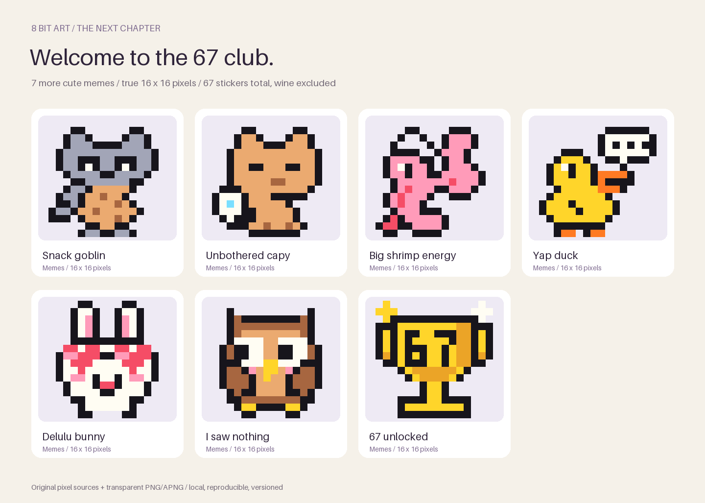
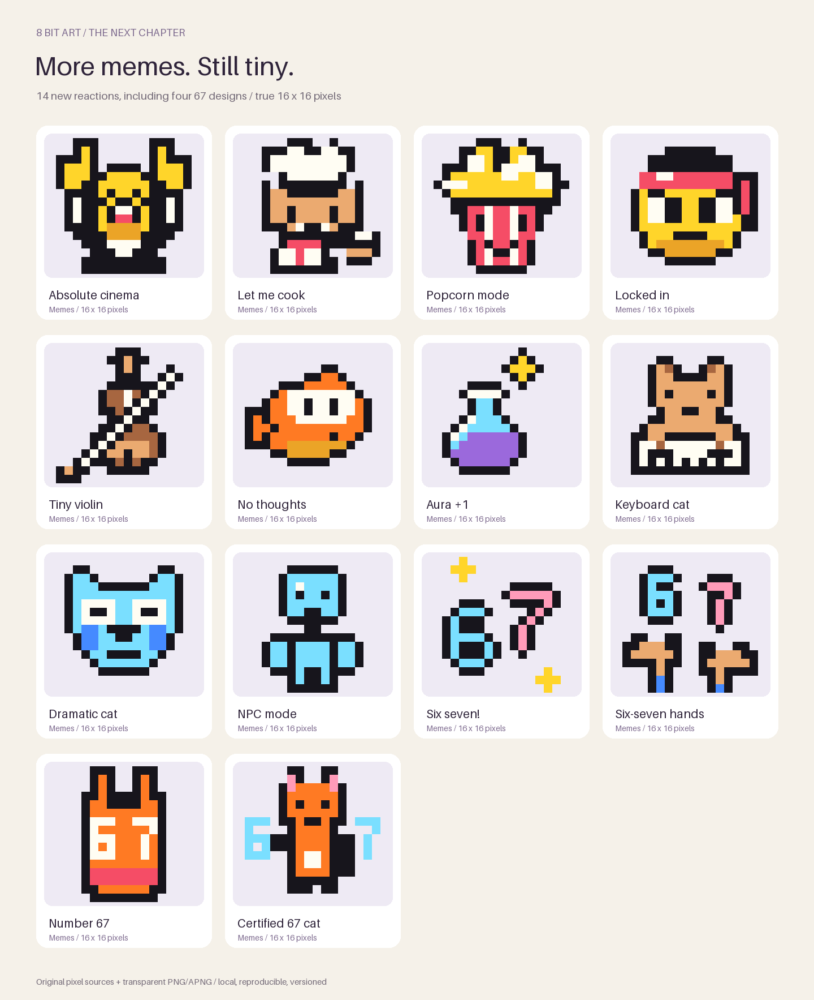
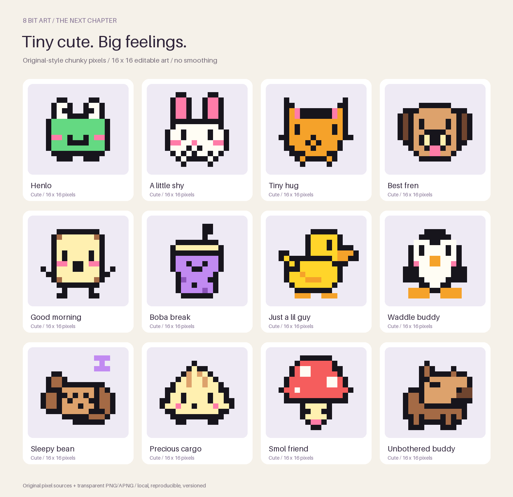
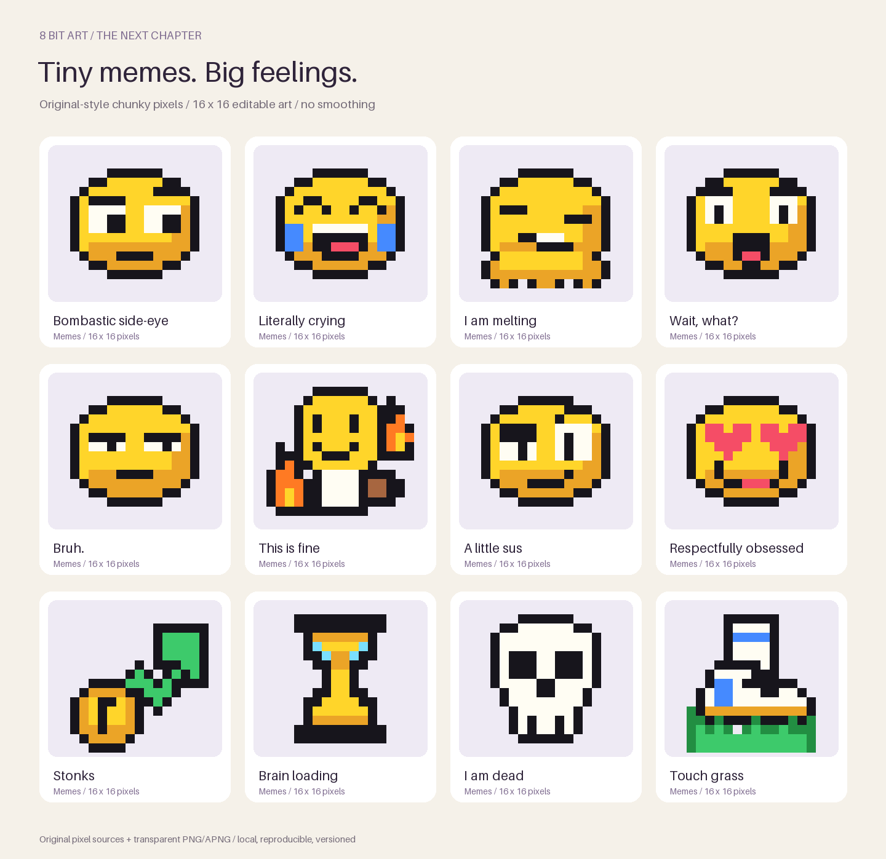
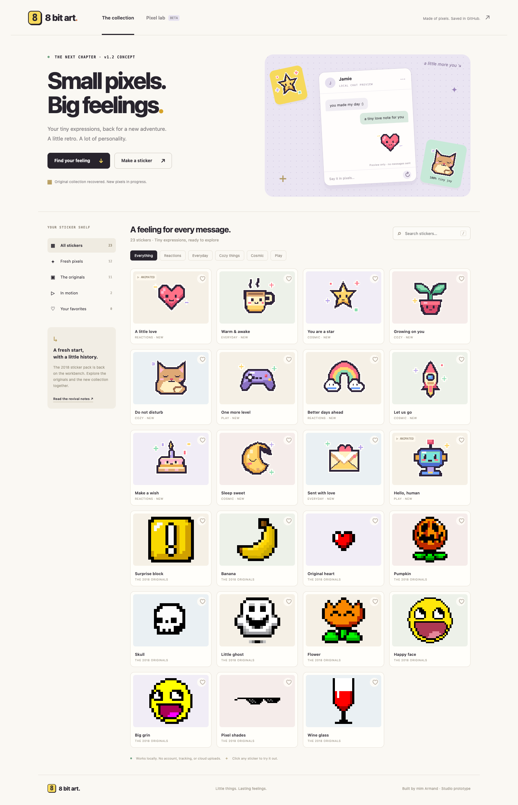

# 8 bit art

**Current release check, October 31:** App Store version **1.4 (10)** is available, but **Studio Unlock has not been submitted/approved** and currently shows **Price unavailable** in production. Corrective **1.4.1 (11)** is being prepared with the first purchase included in the same review draft, readable unlock sheets in Dark Mode and price retry recovery. See [the current correction handoff](docs/studio-purchase-fix.md). Earlier preparation/beta descriptions below are historical.

The 2018 iMessage sticker pack is recovered and back in development. This repository preserves its Git history, Xcode project, original icons and eleven original stickers. The collection now contains **67 stickers**, including **45 cute and meme reactions drawn on a true 16×16 grid**, two animations, a native Studio available in internal TestFlight, and a working local browser prototype.

The latest seven are **Snack goblin, Unbothered capy, Big shrimp energy, Yap duck, Delulu bunny, I saw nothing and 67 unlocked**. They join the previous fourteen memes, bringing the forthcoming additions to **21** and the number-themed set to **five 67 designs**. The collection is included in the prepared **native Studio 1.4 (10)** candidate. The separate sticker-only project remains **1.3 (6)** in source; approved **1.2 (5)** is the 46-sticker public release.









## Try the two MVPs

**iMessage pack — version 1.2 (5), approved and Ready for Distribution.** Fresh Apple readback confirms the original review is complete. It used **automatic release after approval**. The clean signed archive and IPA passed Apple validation/upload with no errors. Build 5 processed as `VALID` and remains selected. Six actual native screenshots have twelve `COMPLETE` placements across iPhone/iPad App Store and iMessage wells.

The **Data Not Collected** App Privacy label was published on October 26, 2026. Version 1.2 (5) was submitted at **3:01 PM CDT**; Apple now reports the update approved and Ready for Distribution. Verified IDs and release evidence are recorded in [release status](release/release-status.json).

Open `8 bit art.xcodeproj` in Xcode and select the shared **8 bit art** scheme. The current development pack, **1.3 (6)**, contains **67 stickers**, including a pulsing heart and blinking robot. It keeps the original bundle identifiers and icon and requires iOS/iPadOS 15 or later. The submitted 1.2 archive can be reproduced from tag `v1.2-build5-submitted`.

```sh
./scripts/build-ios.sh simulator
./scripts/build-ios.sh device
```

These verification builds do not use signing credentials. For simulator installation and the distribution path, see [the native guide](docs/native-mvp.md).

`./scripts/archive-release.sh` uses the current development version/build in `Config/AppStoreMetadata.json` and the installed distribution identity/profiles. It does not upload or submit a release. The submitted build's metadata is preserved in `release/1.2-build5-metadata.json`; its release status and screenshots still describe 1.2 (5). Signing keys and build output remain outside Git.

**Sticker Studio — local browser prototype.** Browse all stickers, filter themes, search, save favorites, try a local conversation preview, and download original PNG/APNG files. The Pixel Lab supports drawing, erasing, flood fill, undo, remixing a sticker and downloading a transparent 300×300 PNG. Favorites and one draft persist in local browser storage when available. The canvas supports pointer/touch input and keyboard arrows + Space; `P`, `E`, `F` switch tools.

```sh
./scripts/start-preview.sh
```

Open **http://127.0.0.1:8787/prototype/**. Python 3 is the only runtime needed to serve the Studio. No npm install, account, API key or external service is needed. Stop the preview server with Ctrl+C. Bind only to localhost as the script does; it serves the repository to that local browser.

The Studio is a working product experiment. Search, favorites, chat previews and the editor are **not bundled into the native sticker pack**. It does not send messages or install exported art into Messages automatically. Editing animation loads one frame and exports a static PNG.

The [public app/support site](https://mim-armand.github.io/8bit-stickers/), [support page](https://mim-armand.github.io/8bit-stickers/support/) and [privacy policy](https://mim-armand.github.io/8bit-stickers/privacy/) are now hosted on **GitHub Pages**. The interactive Studio is **not** published there; it remains localhost only. The owner has chosen a native Studio **inside Messages** on this same listing, with free browsing/search/favorites and a permanent **Studio Unlock** targeting US$1.00. Apple's app-type rules require a new app record for a full home-screen Studio app.

**The [native Studio build and release handoff](docs/native-studio-implementation-plan.md) records the product contract.** It defines the 16×16 editor, multi-draft persistence, StoreKit purchase/restore/offline behavior, source layout, milestone acceptance tests and first-IAP release checklist. The browser editor currently uses a 32×32 grid and is an interaction reference, not the native data model. The native implementation is described below; a draft Studio Unlock product and exact US$1.00 price are configured for sandbox testing. Public submission, app-download pricing and hosting remain unchanged.



## Native Studio — TestFlight and local testing

**Public 1.4 (10) is being prepared for review.** Production StoreKit, the optional exact US$1.00 Studio Unlock and an editable Apple release draft are now prepared. See the [release handoff](docs/studio-release-preparation.md) for signed candidate, screenshots, review status and outstanding device acceptance. This candidate has not been submitted.

**Internal TestFlight 1.4 (8) is available, and the account holder is invited.** Install 8 bit art from TestFlight, open it inside Messages, then choose **Studio → Enable Studio for this beta**. All tools are free during this beta; no purchase is made. See the [TestFlight installation and verification guide](docs/studio-testflight.md). Public 1.2 (5) is now approved and Ready for Distribution.

**Apple sandbox testing is now configured separately for 1.4 (9).** The owner chose to test Apple's actual purchase and restore flow. Studio Unlock is registered with an exact US$1.00 USA price; sandbox purchases make no real charge and do not confer public-release ownership. See the [sandbox testing guide](docs/studio-sandbox.md) for its current build status and device checks. Build 8 retains its free-beta behavior.

The planned Studio is now implemented in a **native Messages build**: free search/favorites for all 67 stickers, an optional one-time $1 test unlock, a true 16×16 editor, 45 exact-grid remix templates, multiple saved drafts, PNG export and actual Messages insertion. It saves as you draw, resumes the requested drawing after unlock, and keeps existing work available after refund/revocation.

Open [`NativeStudio/Studio.xcodeproj`](NativeStudio/Studio.xcodeproj). Choose **Studio Local** to try the shared UI in a simulator preview app, or **Studio Messages Local** for the actual standalone Messages extension. The preview host is a development aid with its own local identity; the intended public app remains inside Messages on the existing listing.

```sh
./scripts/run-native-studio.sh preview
./scripts/run-native-studio.sh messages
```

For an interactive browser view of the **actual native simulator app**, open **http://127.0.0.1:8792/** while `scripts/run-native-viewer.sh SIMULATOR_UUID` is running. This is useful where the Simulator window app is unavailable; it supports tap, drag and text entry, stays on localhost and is excluded from the Messages binary.

Debug builds mark the unlock **Local test — no charge** and simulate payment; the bundled StoreKit configuration also supports Apple's local transaction tests. The **TestFlight** configuration/build 8 uses free beta activation. **TestFlightSandbox**/build 9 requires verified Apple sandbox transactions and displays Apple's localized product price. Normal Release builds disable checkout. The owner-approved IAP availability is configured for the app’s existing 175 territories, with automatic new territories off; Studio Unlock reports READY_TO_SUBMIT and no review is submitted. The separate sticker-only project remains 1.3 (6), and local Debug uses 1.4 (7).

See the [local testing guide](docs/native-studio-local.md) for test controls, StoreKit mode, saved-draft behavior, source layout and remaining production work. Current evidence is in [verification notes](docs/verification.md). Public release remains deferred. The owner has now requested the public candidate preparation described above; the owner explicitly approved the existing 175 territories and that availability is now applied and verified. Physical-device purchase/restore remains to be checked before submission.

## Art you can keep editing

The eight `art/*sprites.json` files contain palette-based pixel commands. All 45 tiny designs use a 16×16 canvas, dark outlines and limited colors with no white rim. `scripts/generate-art.py` generates native catalog additions, browser assets, raw PNGs in `art/pixels/`, animation frames and review boards. All eleven recovered images remain unchanged as source. Ten classics ship; the wine-glass original is retained under `art/recovered/wine_01.sticker/` and excluded from the app and Studio gallery at the owner's request.

The tiny PNGs are truly 16×16. Native 300×300 sticker exports use integer 18× enlargement with six pixels of transparent padding; no smoothing or added detail is introduced. Open a tiny sticker in Studio to download either size.

```sh
python3 -m venv .venv
.venv/bin/pip install -r requirements-art.txt
.venv/bin/python scripts/generate-art.py
python3 scripts/build-preview.py
```

Read [the art guide](art/README.md) for the editable source format and provenance. The new tiny collection includes frog, bunny, cat, puppy, toast, boba, duck, penguin, sleepy bear, dumpling, mushroom and capybara, alongside side-eye, bruh, melting, crying-laughing, sus, heart-eyes and other meme reactions. The previous twelve revival designs remain included. Existing art was recovered as-is; review its provenance before publishing a new release.

## Verification

The submitted 46-sticker candidate passed a clean simulator build and clean signed device archive/export under Xcode 27.1. The new 67-sticker development collection has its own checks recorded in [verification notes](docs/verification.md). Browser checks cover assets, filters, 67 search, persistence, chat previews, downloads, editor tools, undo, PNG dimensions/transparency format, remixing and mobile layout.

Optional browser checks, with the preview server already running:

```sh
npm ci
npx playwright install chromium
npm run test:preview
```

To use an installed Google Chrome instead, run `PLAYWRIGHT_CHANNEL=chrome npm run test:preview`. Tests save review screenshots to `docs/previews/` and an example export under ignored `build/`.

## Releasing the existing app

The published app is **8 bit art, Apple ID 1366485724**, bundle ID **`eu.armand.--bit-art`**. The similarly named unpublished **8-bit art, ID 1366403490**, is a separate record. Update the published record.

The public release is **1.2 (5)** with 46 stickers and API age rating `FOUR_PLUS`. The recovered source was already marked 1.2 (3), so its exact correspondence to the original published 1.1 binary is unverified. The wine-glass artwork is omitted from shipping assets. Build 5 replaced the earlier build 4 and is now **Ready for Distribution**, following its automatic-release approval.

See the [release checklist](docs/release-checklist.md) for publication/submission evidence and optional device checks; [recovery and roadmap](docs/recovery-and-roadmap.md) covers the update path and backup strategy. [App Store listing](docs/app-store-draft.md) records the submitted copy and live support/privacy URLs. [Studio Unlock decisions](docs/monetization-options.md) record the chosen future tools purchase; this submission does not add a purchase or change pricing.

## Repository layout

| Path | Purpose |
| --- | --- |
| `8 bit art.xcodeproj` | Recovered, modernized native project |
| `8 bit art StickerPackExtension/` | Original and new sticker catalogs |
| `art/` | Editable new artwork and manifest |
| `prototype/` | Local Studio, with no production dependencies |
| `scripts/` | Native builds, art generation and browser checks |
| `docs/` | Recovery notes, release draft and visual previews |

Commit source, artwork and generated assets together. Keep credentials and build products out of Git. Tag each submitted build and keep an independent repository/archive backup; instructions are in the roadmap. No general open-source or art license has been added; public repository access does not establish reuse rights.

Support: **seltzer.wisdom7h@icloud.com**.
